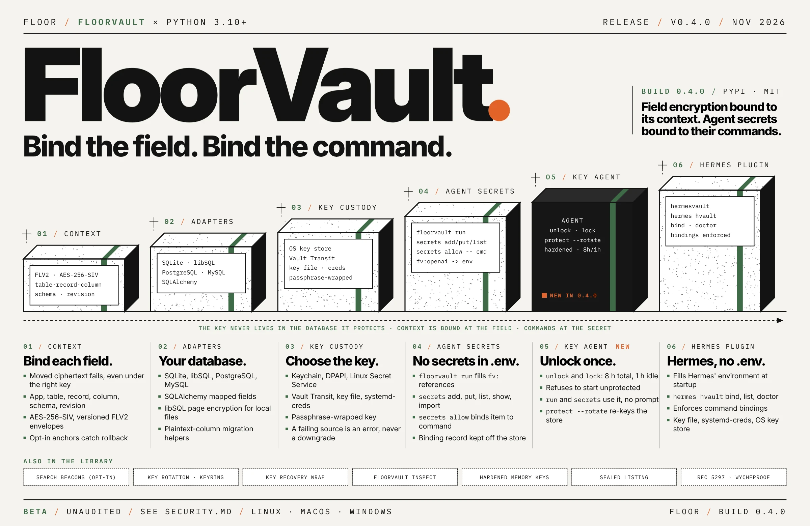
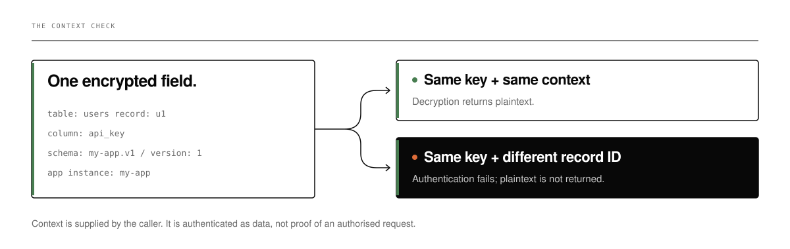

<p>
  
</p>

# FloorVault

**Encrypt the field. Keep the key behind a passphrase. Bind the secret to the command.**

<p>
  <a href="https://pypi.org/project/floorvault/"></a>
  <a href="https://github.com/Guerilla-ops/floorvault/actions/workflows/ci.yml"></a>
  <a href="https://www.python.org/"></a>
  <a href="https://github.com/Guerilla-ops/floorvault/blob/main/SECURITY.md"></a>
  <a href="https://github.com/Guerilla-ops/floorvault/blob/main/LICENSE"></a>
</p>

FloorVault encrypts individual fields in the database you already have and
keeps agent credentials out of `.env`. Every value is bound to where it lives:
ciphertext moved to another row, column, table, schema or application does not
decrypt. Every credential can be bound to the command that may receive it, and
the key itself can sit behind a passphrase that you type once per session.

[Install](#install) · [Quickstart](#quickstart) · [Context binding](#01--context-binding) ·
[Envelope engine](#02--envelope-engine) · [Key custody](#03--key-custody) ·
[Agent secrets](#04--agent-secrets) · [Key agent](#key-agent) ·
[Hermes Agent](#hermes-agent) · [Limits](#security-boundaries) ·
[Documentation](#documentation)

## New in 0.4.0

- **A key behind a passphrase.** `floorvault secrets init --custody passphrase`
  keeps a new store's master key only as a passphrase-wrapped file
  (`master.key.fvpw`, scrypt and AES-SIV), and `floorvault secrets protect` wraps
  the raw key file of an existing store the same way. `secrets protect --rotate`
  moves a store whose key is in the OS key store, a systemd-creds credential,
  `--key-env` or `--key-file` under a passphrase by re-encrypting it under a new
  key; every step is resumable, so run the same command again after an
  interruption.
- **A key agent (Linux and macOS).** `floorvault unlock` asks for the passphrase
  once and leaves a hardened background agent holding the key (8 hours in total
  and 1 hour idle by default, counted through sleep); `floorvault lock` wipes it.
  While it runs, `floorvault run` and `floorvault secrets` use it with no prompt
  and no terminal, so an MCP client or a service can resolve secrets. The agent
  refuses to start unless core dumps are off and debuggers are blocked
  (`--allow-unhardened` overrides this, with a warning), is forked before the
  passphrase is asked for, and checks every directory above its
  socket. It gives up after 15 minutes if its starter never delivers the key,
  does not take a busy agent for a stale socket, and cannot be stopped by a
  cleanup aimed at an earlier agent.
- **Hermes plugin 0.4.0.** `hermes hvault bind` sets up a store and maps a
  variable in one step (`--stdin` takes the value from a pipe), and
  `hermes hvault allow` binds an item to the command line Hermes runs as, without
  leaving Hermes. `hermes hvault doctor` prints the warnings Hermes prints at
  startup instead of a count, `hermes hvault` no longer needs PyYAML, and the
  warning for a skipped item names a command line you can bind.

Upgrading from 0.3.x needs no data migration, and a store that already uses a key
file, systemd-creds or the OS key store keeps working as it is. Full notes:
[v0.4.0 release](https://github.com/Guerilla-ops/floorvault/releases/tag/v0.4.0).

**Beta.** No completed independent code audit or security certification is claimed.
Read [SECURITY.md](https://github.com/Guerilla-ops/floorvault/blob/main/SECURITY.md)
before choosing a deployment.

## Install

Requires Python 3.10 or newer:

```bash
python -m pip install floorvault
```

| Optional extra | Adds |
| --- | --- |
| `macos` | macOS Keychain bindings |
| `linux` | Linux Secret Service client |
| `sqlalchemy` | SQLAlchemy integration |
| `libsql` | Synchronous libSQL driver |
| `postgres` | Psycopg driver |
| `mysql` | MySQL Connector/Python driver |
| `hermes` | PyYAML, for `floorvault secrets import --hermes --remove-from-env` |
| `dev` | Development and verification tools |

For example, `python -m pip install "floorvault[linux]"`. The base install does
not enable every native key store. To work from the repository instead, clone
and `python -m pip install .`; the distribution, package and CLI are all named
`floorvault`.

## Quickstart

This example uses an ephemeral key and needs no external key store. For persistent
records, retain the original key through a custody provider: generating a new key
at each start makes existing data unreadable.

```python
from secrets import token_bytes

from floorvault import DecryptionVerificationError, FloorVault

with FloorVault(token_bytes(32), app_instance_id="example-app") as crypto:
    ciphertext = crypto.encrypt(
        "secret value", table="credentials", record_id="user-123", column="token"
    )
    assert crypto.decrypt(
        ciphertext, table="credentials", record_id="user-123", column="token"
    ) == "secret value"

    try:
        crypto.decrypt(
            ciphertext, table="credentials", record_id="user-456", column="token"
        )
    except DecryptionVerificationError:
        print("Different record: authentication rejected.")
    else:
        raise AssertionError("Wrong-context ciphertext was accepted")
```

<a id="features"></a>
<a id="context-binding"></a>

## 01 / Context binding

**Bound data.** Every encrypted field is authenticated together with its
coordinates: application instance, table, record, column, schema ID and schema
version. Decryption rebuilds them from what the caller expects, so a value moved
to another row or column fails with `DecryptionVerificationError`, even under the
right key.



Binding alone does not catch an old value written back to the same place.
Opt-in revisions and external freshness anchors detect that rollback, given state
kept outside the attacker's reach.

> **Context is not permission.** Your application chooses the expected coordinates
> and decides who may read them.

[Context binding and freshness](https://github.com/Guerilla-ops/floorvault/blob/main/docs/USAGE.md#context-binding-and-freshness)

## 02 / Envelope engine

**AES-256-SIV.** A misuse-resistant AEAD (RFC 5297) in a versioned `FLV2`
envelope. HKDF-SHA256 derives a separate subkey for each purpose (field
encryption, search beacons, libSQL file encryption, freshness anchors) from one
32-byte master key. The coordinates, the envelope header and the nonce are all
authenticated as associated data.

- **Database adapters:** SQLite, libSQL, PostgreSQL, MySQL and SQLAlchemy table
  integrations, plus opt-in libSQL page encryption.
- **Checked against:** the RFC 5297 test vectors, Project Wycheproof's AES-SIV
  vectors, fixed wire-format vectors, and fuzzing in CI.
- **`floorvault inspect`** checks one encrypted SQLite field from the command line.

[Protocol specification](https://github.com/Guerilla-ops/floorvault/blob/main/docs/SPEC.md) ·
[Database adapters](https://github.com/Guerilla-ops/floorvault/blob/main/docs/USAGE.md#database-adapters)

## 03 / Key custody

**Keep the key.** The master key comes from a custody provider and is never
stored in the database it protects:

| Source | Notes |
| --- | --- |
| macOS Keychain | `macos` extra |
| Windows DPAPI | Bound to the Windows account |
| Linux Secret Service | `linux` extra |
| HashiCorp Vault Transit | Wraps the master key remotely; encryption stays local |
| Passphrase-wrapped key | `floorvault secrets init --custody passphrase`; unlock once with `floorvault unlock` (Linux and macOS) |
| systemd-creds | `floorvault secrets init --custody systemd-creds`; Linux, systemd 256 or newer |
| Key file | `--key-file` or `$FLOOR_VAULT_KEY_FILE`, such as a Docker or Kubernetes secret mount |
| Environment or an explicit key | `FLOOR_VAULT_KEY`, or bytes you supply |
| Local file | Off by default; can be passphrase-wrapped |

A configured key source that fails is an error, never a silent downgrade to a
weaker one. Key material is held in buffers that can be wiped after use.

> **Lose the key, lose the data.** Keep recovery material backed up, and reopen a
> store with the same key, service and application context it was created with.

[Key custody](https://github.com/Guerilla-ops/floorvault/blob/main/docs/USAGE.md#key-custody) ·
[Vault Transit guide](https://github.com/Guerilla-ops/floorvault/blob/main/docs/VAULT-TRANSIT.md)

<a id="keep-agent-secrets-out-of-env"></a>

## 04 / Agent secrets

**No secrets in `.env`.** `floorvault run` starts any command, such as an agent,
an MCP server or a script, with `fv:` references filled in from an encrypted local
store. Configs and `.env` files then hold only references, which are safe to sync
or commit:

```bash
read -rs KEY && printf 'value=%s\n' "$KEY" | floorvault secrets add "OpenAI" --id openai --stdin; unset KEY
floorvault secrets allow openai -- python ~/agent.py
echo 'OPENAI_API_KEY=fv:openai' > .env
floorvault run --env-file .env -- python ~/agent.py
```

- `floorvault secrets import .env` previews moving an existing file's values into
  the store; add `--write` to store them and rewrite the file to references.
- `floorvault secrets allow` binds an item to the command lines it may reach;
  `run` refuses items with no binding, and one whose binding was changed in the
  store behind its back.
- The store is `VaultStore`, a local credential database with optional sealed
  listing metadata, also usable directly from Python.
- A [Hermes Agent plugin](#hermes-agent) in this repository loads vault items
  into Hermes' environment at startup and enforces the same bindings.

> **The process you start sees plaintext,** and so can other code running as you.
> A binding stops mistakes and untrusted configuration, not someone who can write
> `vault.db`.

The [walkthrough](https://github.com/Guerilla-ops/floorvault/tree/main/examples/agent-secrets)
has a references-only `.env`, an MCP client config, and what this does and does
not protect.

[Run any command with vault secrets](https://github.com/Guerilla-ops/floorvault/blob/main/docs/USAGE.md#run-any-command-with-vault-secrets) ·
[Credential stores](https://github.com/Guerilla-ops/floorvault/blob/main/docs/USAGE.md#credential-stores) ·
[Hermes Agent](https://github.com/Guerilla-ops/floorvault/blob/main/docs/USAGE.md#hermes-agent-integration)

<a id="key-agent"></a>

### Key agent

For interactive work on a host with no OS key store, keep the key under a
passphrase and unlock it once:

```bash
floorvault secrets init --custody passphrase          # new store: asks twice
floorvault unlock                                     # asks once; a hardened agent holds the key
floorvault run --env-file .env -- python ~/agent.py   # no prompt while it is unlocked
floorvault lock                                       # wipe the key and stop the agent
```

`floorvault unlock --status` reports a running agent, and `--ttl` and `--idle` set
its limits. A store whose key is somewhere else moves under a passphrase with
`floorvault secrets protect --rotate` (add `--key-file PATH` or `--key-env NAME`
for a key you supply). It re-encrypts every item under a new key and removes the
credential or marker file beside the store that held the old one. It does not
touch the shared OS key store entry, a key file or an environment variable:
retire those yourself. A copy or backup made before still opens with the old key.

> **The agent is a decryption oracle for code running as you.** It never hands
> out the key, but any process of yours that can reach its socket can ask it to
> decrypt anything in the store. Bindings are checked by the caller, not by the
> agent. A reboot ends it, and root is out of scope.

[Passphrase-protected key and key agent](https://github.com/Guerilla-ops/floorvault/blob/main/docs/USAGE.md#a-passphrase-protected-key)

<a id="hermes-agent"></a>

### Hermes Agent

The [hermesvault plugin](https://github.com/Guerilla-ops/floorvault/tree/main/plugins/hermesvault)
fills Hermes' environment from the store at startup, so provider keys stay out of
Hermes' `.env`. It never prompts, and it holds agent credentials only.

```bash
hermes plugins install Guerilla-ops/floorvault/plugins/hermesvault
hermes plugins enable hermesvault
hermes hvault bind OPENAI_API_KEY                           # prompts; stores, maps and binds it to Hermes' gateway line
hermes hvault allow openai_api_key -- hermes gateway run    # a service's own line, if Hermes runs as one
hermes hvault doctor                                        # mappings and .env precedence; never prints a value
```

`bind` binds a new item to the command line Hermes starts its local gateway with,
which is where chat and one-shot commands resolve secrets (`--no-bind` to skip
that). A bound item resolves only when Hermes was started with one of its bound
command lines; otherwise it is skipped with a warning that prints the line to bind.
Delete the key from Hermes' `.env` after binding it: while a plaintext copy is
there it takes precedence, and `doctor` flags it.

- The plugin needs floorvault 0.2.8 or newer. `hermes hvault allow` needs 0.3.0
  or newer; with 0.2.x, bind with `floorvault secrets allow`.
- It does not support a passphrase-protected store, because it never prompts. Use
  the OS key store, a key file or systemd-creds for a store Hermes reads.
- `hermes hvault allow` keeps a binding record outside the store, so a later
  `allow` refuses a binding changed behind its back, but startup resolution does
  not consult it; see [Security boundaries](#security-boundaries).

[Plugin README](https://github.com/Guerilla-ops/floorvault/blob/main/plugins/hermesvault/README.md) ·
[Hermes Agent](https://github.com/Guerilla-ops/floorvault/blob/main/docs/USAGE.md#hermes-agent-integration)

## Security boundaries

Beta, unaudited, no policy broker, and search beacons leak equality. In detail:

| Property | Limit |
| --- | --- |
| Confidentiality | Only encrypted fields are protected by default. Other columns, schema, counts, lengths and access patterns remain visible. |
| Context integrity | The caller must provide trustworthy expected coordinates. Context does not establish permission. |
| Freshness | Opt-in revisions or external anchors require trusted state outside the attacker's rollback control. |
| Equality search | Optional beacons reveal bucket, frequency and access-pattern information. Decrypt candidates to confirm matches. |
| Memory | Managed buffers can be wiped; other copies may persist, including the `cryptography` library's own copy of the AES-SIV subkey inside its engine. Page locking and anti-dump measures do not create an enclave. |
| Migration | Deletion does not guarantee erasure from WAL, pages, backups, snapshots or storage media. |
| Agent access | A compromised or prompt-injected authorised caller can request genuine plaintext. The library does not supply a policy broker. |
| Key agent | While unlocked, code running as you can ask the agent to encrypt or decrypt any item; it hands out plaintext, not the key. It refuses to start without core-dump and debugger protection unless `--allow-unhardened` is given, and it is not an enclave. The macOS peer-credential check and the suspend-inclusive clock have not been run on a real Mac outside CI. |
| Passphrase | The wrapping is only as strong as the passphrase, and there is no recovery: lose the passphrase or `master.key.fvpw` and the data is gone. After `protect --rotate`, backups made before still open with the old key, and an external key file, environment key or the shared OS key store entry is not retired for you. |
| Command binding | Guards against mistakes and untrusted config. From 0.3.0 `run` keeps a record of each binding outside the store and refuses one that was cleared or rolled back in `vault.db`. An item's first use is trusted, and the state directory must persist and stay outside the store writer's control; restoring both the store and record can replay an older, wider binding undetected. `hermes hvault allow` keeps the same kind of record, so a later `allow` refuses a binding changed behind its back, but the plugin's startup resolution does not consult it: a binding rolled back in `vault.db` still resolves there, and a cleared one is refused only with `require_binding: true`. |

## Documentation

- [Usage guide](https://github.com/Guerilla-ops/floorvault/blob/main/docs/USAGE.md) — adapters, stores, custody, plugin, compatibility
- [Security policy](https://github.com/Guerilla-ops/floorvault/blob/main/SECURITY.md)
- [Protocol specification](https://github.com/Guerilla-ops/floorvault/blob/main/docs/SPEC.md)
- [Record format](https://github.com/Guerilla-ops/floorvault/blob/main/docs/RECORD-FORMAT-2026-09-15.md)
- [Audit packet](https://github.com/Guerilla-ops/floorvault/blob/main/docs/AUDIT-PACKET.md)
- [Vault Transit guide](https://github.com/Guerilla-ops/floorvault/blob/main/docs/VAULT-TRANSIT.md)
- [Release guide](https://github.com/Guerilla-ops/floorvault/blob/main/docs/RELEASING.md)

The [hardware custody guide](https://github.com/Guerilla-ops/floorvault/blob/main/docs/HARDWARE-CUSTODY.md)
is a proposal, not a shipped hardware provider. Historical reviews and benchmarks
apply to their stated revisions and workloads; they are not certification of the
current source.

## Development

```bash
uv sync --extra dev
uv run pytest
bash scripts/security-check.sh
```

CI covers Ubuntu/macOS/Windows across the supported Python range; see
[docs/CI.md](https://github.com/Guerilla-ops/floorvault/blob/main/docs/CI.md) and
the [development notes](https://github.com/Guerilla-ops/floorvault/blob/main/docs/USAGE.md#development).

Report vulnerabilities through [private GitHub reporting](https://github.com/Guerilla-ops/floorvault/security/advisories/new)
or **floorbond@pm.me**. Keep security reports and live secrets out of public issues.

Licensed under the [MIT License](https://github.com/Guerilla-ops/floorvault/blob/main/LICENSE).
