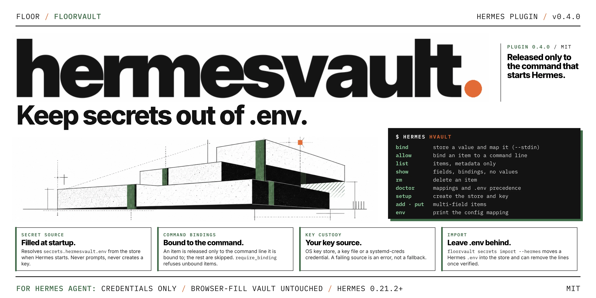

<p>
  
</p>

# hermesvault: FloorVault secret source for Hermes Agent

**Keep secrets out of `.env`. Released only to the command that starts Hermes.**

`hermesvault` is a [Hermes Agent](https://github.com/NousResearch/hermes-agent)
secret-source plugin. At startup it resolves the environment variables you map
in `secrets.hermesvault.env` from a local [FloorVault](https://github.com/Guerilla-ops/floorvault)
store (AES-256-SIV, context-bound records). It also adds a `hermes hvault`
command for managing that store.

It holds agent credentials only. The browser-fill login vault at
`<profile-home>/vault` is never opened or migrated.

- **Never prompts at startup.** The source runs inside Hermes and never unlocks,
  creates or asks for anything. A missing store or key, or a locked Secret Service
  collection, is reported and Hermes starts without those variables.
- **Bound to the command.** `hermes hvault allow` (floorvault 0.3.0 or newer;
  `floorvault secrets allow` works too) records the command lines an item may
  reach. The plugin compares them with the command line Hermes was started with and
  otherwise skips the item, with a warning that names a line you can bind.
  `secrets.hermesvault.require_binding: true` also skips items that have none.
- **Your key, your custody.** The store key comes from the OS key store, a key file
  (such as a Docker or Kubernetes secret mount) or a systemd-creds credential. A
  configured custody that fails is an error, never a quiet fallback. A
  passphrase-protected store is not supported.
- **`hermes hvault`** manages the store: `bind`, `allow`, `list`, `show`, `rm` and
  `doctor`, plus `setup`, `add`, `put` and `env` for scripts.

## Install

```bash
hermes plugins install Guerilla-ops/floorvault/plugins/hermesvault
hermes plugins enable hermesvault
```

Hermes asks for consent to install the plugin's Python dependencies, which come
from PyPI:
- `floorvault>=0.2.8,<0.5` (0.2.8 is the first release that can hold and read
  command bindings, which the plugin enforces; see
  [Command bindings](#command-bindings));
- `secretstorage` on Linux;
- `pyobjc-framework-Security` on macOS.

The plugin directory contains no copy of FloorVault. Restart Hermes after
enabling the plugin, then bind your first secret:

```bash
hermes hvault bind OPENAI_API_KEY
```

`bind` does everything a first run needs: it creates the store and its key if
they do not exist yet (in the OS key store, where it may show the unlock prompt,
or as a systemd-creds credential; see [Key custody](#key-custody)), prompts for
the value without echo, stores it as item `openai_api_key`, writes the
`secrets.hermesvault.env` mapping into config.yaml and runs `doctor`. Restart
Hermes and the variable is set, unless the profile's `.env` already sets it: with
the default `override_existing: false` the `.env` value wins, so delete that line
first (see below). Where Hermes cannot write the configuration
(older releases, managed configs, `--print-only`), `bind` prints the mapping to
paste instead.

`hermes hvault` with no command prints the store, custody and mapping status
and the next step. Nothing but `bind` and `setup` ever creates or prompts: the
secret source runs at Hermes startup and never prompts, unlocks, or creates a
key, a credential or a store. If the store is missing, the key is missing, or
the Linux Secret Service collection is locked, the source reports an error and
Hermes starts without those variables.

Check an install with `hermes plugins doctor hermesvault`.

## Configure

```yaml
# ~/.hermes/config.yaml
secrets:
  hermesvault:
    enabled: true
    env:
      SERVICE_TOKEN: hv:vault_service        # the item's `value` field, or its only field
      DB_PASSWORD: hv:vault_db:password      # a named field
    # dir: agent-vault                       # default <profile-home>/agent-vault
    # token_env: HERMES_VAULT_KEY            # bootstrap key variable (64 hex chars)
    # custody: os                            # os, key_file or systemd-creds
    # key_file: /run/secrets/hermes-vault    # with custody: key_file
    # override_existing: false
    # require_binding: false                 # refuse items with no command binding
```

A reference has the form `hv:<item_id>[:<field>]`. An item with several
fields needs an explicit field. A reference that can't be resolved is skipped
with a warning; it never sets an empty value.

**Remove each mapped key from `.env`.** Hermes loads `<profile-home>/.env`
before secret sources run. With `override_existing: false` (the default), a
variable that `.env` already sets keeps its `.env` value, and the vault value is
skipped without an error. Leaving a key in both places therefore keeps using the
plaintext copy. After mapping a key, delete its line from `.env`; `hermes status`
then counts it in `FloorVault: applied N secret(s)`. Setting
`override_existing: true` makes the vault win instead, but the plaintext copy
stays on disk.

`floorvault secrets import` will not rewrite a Hermes `.env` to references:
Hermes reads that file itself, so references there would replace the real
values. Move Hermes keys with `floorvault secrets import --hermes` instead. It
stores each value in this plugin's store, prints the `secrets.hermesvault.env`
block to add to `config.yaml`, and with `--write --remove-from-env` deletes the
imported lines from `.env` once enabled YAML mappings, the configured store and
plugin-key decryption have been verified (afterwards `hermes doctor`
warns that no API key is in `.env`, and `hermes status` can name a different
provider; chat uses the vault key). See
[USAGE](../../docs/USAGE.md#run-any-command-with-vault-secrets). Or move keys one
at a time with `hermes hvault` as above.

The companion removal check requires `floorvault[hermes]` (PyYAML). The
`floorvault secrets` command line is in floorvault 0.2.8 and newer, which the
plugin now requires; install `floorvault[hermes]` where you run the import.

## Manage items

```bash
hermes hvault                                # status and next step
hermes hvault bind SERVICE_TOKEN             # store a value, map it, bind it to the gateway line (creates the store if needed)
hermes hvault bind SERVICE_TOKEN --no-bind   # ...leaving the item unbound (resolves for any command)
hermes hvault bind SERVICE_TOKEN --stdin     # ...with the value piped in from a password manager
hermes hvault bind DB_PASSWORD --id vault_db --field password   # a named field on a chosen item
hermes hvault allow <item_id> -- <line>      # bind it to another command line, such as a service's
hermes hvault list                           # metadata only
hermes hvault doctor                         # check mappings, custody and precedence
hermes hvault show hv:<item_id>              # field names and status, and bindings; never plaintext
hermes hvault rm <item_id>
```

Advanced, for scripts and multi-field items:

```bash
hermes hvault setup                          # create the store and key without binding anything
hermes hvault add "Service token" --stdin    # field=value lines on stdin
hermes hvault put <item_id> <field>          # prompts for the value
hermes hvault env <item_id> SERVICE_TOKEN    # prints the config.yaml mapping
```

Prefer `--stdin` or `put` to `field=value` arguments, which show up in process
listings. A malformed line is reported by its number (`stdin line 3`), never
echoed, since it may be the secret itself. `put` replaces one field inside a single SQLite transaction.

`hermes hvault doctor` checks the active profile's configuration and existing
store, attempts to resolve each mapping, and reports variables shadowed by the
current environment or protected as the bootstrap key. Exit status is 0 when
all configured mappings resolve without these issues, 1 for operational issues
(including a disabled source or no mappings), and 2 for malformed configuration.
It never prints credential values and does not create a missing vault. It opens
the store exactly as the secret source does at startup: no prompt, no key or store
created. With `override_existing: true` it reports that
existing values will be replaced; it does not remove plaintext files. Restart
Hermes and verify the actual service after changes: the command checks its own
process environment, not a running gateway or another profile.

CLI commands reject malformed IDs/environment names before opening the store.
`env` safely quotes its YAML output but does not verify that an item exists;
use `doctor` after merging that output into the profile configuration. Configuration
load errors or Hermes' `FailedConfigRead` fallback stop commands instead of
silently selecting the default store.

`hermes hvault` is a Hermes CLI subcommand, so it is available under the
default `plugins.isolation: in_process`. Under `plugins.isolation: host`, Hermes
skips plugin CLI commands; the secret source itself still works.

## Key custody

The store's master key is the 64-hex-character key in the variable named by
`token_env`, read from the environment Hermes gives this source for the profile
being fetched (under the multiplex gateway, that profile's scope, not the launch
environment). Without it, the key comes from the custody the profile sets in
`custody`:

| `custody` | Where the key is | Use it for |
|---|---|---|
| `os` (default) | the OS key store (macOS Keychain, Windows DPAPI, Linux Secret Service) through FloorVault's `AdaptiveKeyProvider`, with its environment tier turned off | desktops and laptops |
| `key_file` | the file named by `key_file` (absolute, or relative to the profile home), holding 64 hex characters | containers and servers with an orchestrator secret mount (Docker/Kubernetes secret on tmpfs) |
| `systemd-creds` | `master.key.sdcred` beside the store, sealed by `systemd-creds encrypt --user` and unsealed with `systemd-creds decrypt --user` | Linux servers with systemd 256 or newer and no Secret Service |

`FLOOR_VAULT_KEY`, `VAULT_MASTER_KEY` and `FLOOR_VAULT_KEY_FILE` are never read,
so a key in another profile's environment never unlocks this store. The source
also declares them, besides `token_env`, as protected, so a mapped secret can
never overwrite them. A configured custody that fails is reported and nothing
falls back to another one; `key_file` is refused unless `custody: key_file`.

**`key_file`.** The file is checked as `floorvault run --key-file` checks it:
symlinks (Kubernetes `..data`) must lead to a regular file, owned by you or root
and not writable by group or others. A file readable by others is used, with a
warning. `hermes hvault setup` creates the store under that key; it never
creates or changes the key file. The file is as strong as its permissions: on
a host's disk it protects against other users, not against code running as you
or against a copy of the disk.

**`systemd-creds`.** `hermes hvault setup` creates a random key, seals it to this
user and machine with `systemd-creds encrypt --user`, checks that it unseals,
and creates the store. It does this for a new store only: beside an existing
store it refuses, because a new key would fork the store's key. Setup does the
same as `floorvault secrets init --custody systemd-creds`, so a store made either
way opens either way. At startup the source runs `systemd-creds decrypt --user`
(found only in system directories, with a minimal environment, the key passed
through a pipe) and never creates a credential. Without systemd 256 or newer it
fails closed. **Not checked on a real host:** unsealing from a service or a
session with no login, which is how Hermes often runs. Restart Hermes and run
`hermes hvault doctor` in the same kind of session before relying on it. See
FloorVault's [docs/USAGE.md](https://github.com/Guerilla-ops/floorvault/blob/main/docs/USAGE.md)
for what systemd's automatic key selection does and does not protect.

On Linux every store using `os` custody shares one Secret Service entry
(`floor-vault` / `default-v1`). The first key for it is created under a per-user
lock (`$XDG_RUNTIME_DIR/floorvault`, else `~/.cache/floorvault`), so two stores set
up at the same time get the same key; if two entries with different keys exist
anyway (for example made by an older version), opening is refused rather than one
being picked, and no entry is overwritten or removed. On a host with no usable OS
key store and no `token_env` key, `os` custody fails closed; use `key_file` or
`systemd-creds` there. A store holding a systemd-creds credential is refused
under `os` custody with a message naming `custody: systemd-creds`.

`floorvault secrets import --hermes` stores under the same key: `$HERMES_VAULT_KEY`
(or `--key-env`), else `--key-file` (then set `custody: key_file` and `key_file`
to that file), else a credential beside the store (`custody: systemd-creds`),
else the OS key store; the mapping it prints includes the `custody` lines. With
`--remove-from-env` it deletes the `.env` lines only after opening the store the
way the plugin will, and, for `key_file` or `systemd-creds`, only if the plugin
installed in the profile (`<profile-home>/plugins/hermesvault`) is 0.2.8 or newer.
Keep the same custody settings and the `floor-agent` application context when
reopening an existing store. See FloorVault's
[SECURITY.md](https://github.com/Guerilla-ops/floorvault/blob/main/SECURITY.md)
for the custody model and its limits.

## Command bindings

A new item made by `hermes hvault bind` is bound to the command line Hermes
starts its local gateway with, where chat and one-shot commands resolve secrets:
this interpreter, `-m hermes_cli.main`, `--profile default` unless the profile
home is a `profiles/<name>` directory, then `gateway run --quiet --idle-exit`.
`bind --no-bind` leaves the item unbound. A Hermes run by a service, by hand or
on Windows has its own line; `bind` says so and the item stays unbound until you
bind that line as below. An existing item's bindings are never changed by `bind`.

`hermes hvault allow` binds an item to command lines without leaving Hermes: it
opens the same store with the configured custody, so there are no `--vault` or
key flags to translate. Inside Hermes the command is Hermes itself, so the
plugin resolves a bound item only when the command line Hermes was started with
is one of the item's bindings, and skips it with a warning otherwise. Other
items in the same `env` map still resolve.

```bash
hermes hvault allow service_token            # bind to the command line Hermes was just started with
hermes hvault allow service_token -- hermes gateway run   # ...or spell it out
hermes hvault allow service_token --remove -- hermes gateway run  # drop one line
hermes hvault allow service_token --clear    # unbind: resolves for any command
hermes hvault show hv:service_token          # lists what it is bound to
```

With no `--` the command records the command line(s) the *current* process was
started with — useful when you launch Hermes through a wrapper script and run
`allow` from inside that script. Lines that are `hvault` invocations themselves
are never recorded silently: bound only to those, the item would resolve for
hvault commands but not the agent, so `allow` refuses and tells you to pass the
line explicitly. The usual flow is to start Hermes the way you normally do; when
a bound item is skipped, the startup warning prints the exact line to put after
`--`. For a Hermes started by a service/launcher, `hermes
--print-runtime-command gateway run` prints that line as JSON — paste it quoted
after `--` and `allow` takes it as-is. After `--`, the program is an absolute
path or a name on `PATH`, resolved
the same way as when it runs. `--remove` refuses to drop the last remaining
line: that would widen the item to every command, and `--clear` is the explicit
way to do that. `allow` also notices when a binding was changed by something
else since the last `allow` — rerun with `--accept` to take over the new set
(`allow` needs floorvault 0.3.0 or newer for its sealed binding record; with 0.2.x
bind with `floorvault secrets allow`).

- **What is compared.** `hermes gateway run` is `[<path of hermes>, gateway, run]`;
  `python -m hermes_cli gateway run` is `[<path of python>, -m, hermes_cli,
  gateway, run]`. Either spelling can be the one you bound, and the warning for a
  mismatch prints what Hermes saw. Only an absolute program path can match: after
  startup the plugin can no longer tell which directory a relative `./hermes` was
  relative to, so start Hermes with its absolute path (a systemd unit's
  `ExecStart` already is one). An item bound to several lines resolves for any
  of them. Every Hermes command that loads secrets (`gateway run`, `chat`, ...)
  has its own line, so bind the ones that need the item.
- **Chat and one-shot commands run through Hermes' local gateway.** `hermes -z "..."`
  and other commands that talk to the agent start a gateway process, and the secrets
  are resolved there, so that process's command line is the one to bind, not the
  one you typed. With the Hermes checked (a source install) it is
  `<python> -m hermes_cli.main --profile default gateway run --quiet --idle-exit`,
  where `<python>` is the interpreter Hermes runs under. The flags are Hermes' to
  change, so copy the line from the warning: when an item is skipped, the warning
  prints the line(s) `secrets allow` can record. The gateway keeps running after the
  command returns and keeps the decision it made at startup, so after changing a
  binding run `hermes gateway stop`, or the old decision answers the next command.
- **`require_binding: true`** also skips items that have no binding. A binding is
  stored in `vault.db`, so whoever can write that file can clear one without the
  key; the setting lives in Hermes' configuration, so a cleared binding then
  blocks the item instead of releasing it. Without it, an unbound item resolves
  for any command, as before.
- **Not the same as `floorvault run`.** The plugin runs inside Hermes after it
  started, so it cannot refuse variables that steer what Hermes loads
  (`PYTHONPATH`, `LD_PRELOAD`), which `run` checks for bound items. Resolution
  does not consult the record `allow` keeps outside the store, so an older,
  wider binding written back into `vault.db` still resolves — the next `allow`
  notices the change and refuses until `--accept`. A binding guards against mistakes
  and against another command using the same profile; it does not stop code
  running as you, or anything that can start Hermes with the command you bound.
- **A binding that cannot be read** (it fails authentication, or it was moved
  from another item) skips the item; it is never taken as "unbound".
- **floorvault 0.2.x** (from 0.2.8) reads and enforces bindings, but cannot
  write them from Hermes: `hermes hvault allow` needs the sealed binding record
  of floorvault 0.3.0 and refuses, so bind with `floorvault secrets allow` there
  (the skip warning names the command that works with the installed version).
  **floorvault older than 0.2.8** cannot read bindings: resolution warns that
  they are not enforced, and with `require_binding` it resolves nothing.

## What this plugin does on your machine

- **Reads** a FloorVault store under `<profile-home>/agent-vault` (or
  `secrets.hermesvault.dir`) at startup, and only reads. `hermes hvault` commands
  write to it; `hermes hvault setup` and a first `hermes hvault bind` create it.
- **Writes one mapping to config.yaml**, only during `hermes hvault bind`, through
  Hermes' own configuration writer, which merges into the existing file. Nothing
  else in the plugin touches the configuration; `--print-only` turns the write
  into printed YAML.
- **Reads its own master key** from the `token_env` variable, else from the custody
  configured in `custody`: the OS key store (service `floor-vault`, the default),
  the file named by `key_file`, or the systemd-creds credential beside the store. It never reads other tools' credential stores, `.env`
  files or Hermes' `auth.json`. Any other FloorVault `VaultStore` on the same
  account that uses default custody (for example an app built on
  `floorvault.vaultkit`, whose default store is `~/.floor/vault`) uses the same
  key-store entry and application context, so those stores are separated by
  directory, not by key. Set `token_env` to give the agent vault its own key.
  Hermes' own browser-fill vault is a separate implementation with its own key.
- **Returns plaintext secrets** to Hermes, which places them in the agent's
  environment. Hermes applies them; the plugin never writes `os.environ`.
- **Starts one subprocess, only with `custody: systemd-creds`:** the system's own
  `systemd-creds` (`decrypt --user` at startup; `encrypt` and `decrypt` during
  `hermes hvault setup`), as an argument list with no shell and a minimal
  environment. Otherwise no subprocesses.
- **No network calls**, no shell commands, no background processes, no telemetry.

## Develop

From a FloorVault checkout, with a Hermes checkout at `HERMES_AGENT_SRC`:

```bash
HERMES_AGENT_SRC=~/hermes-agent pytest tests/test_hermes_plugin.py \
  tests/test_hermes_plugin_packaging.py
hermes plugins validate plugins/hermesvault --install-deps
```

The tests that need Hermes skip without a checkout, and a skip proves nothing
about host compatibility.

## License

MIT, the same as FloorVault.
